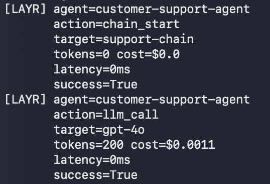

# Layr

**Observability for AI agents.** Instrument your agents in a few lines of code and get full visibility into every action, decision, and resource they consume — works with the observability stack you already have.

## Requirements

- Python 3.10+

## Installation

Install the package from PyPI (the distribution name is `layr-sdk`; you import the `layr` module in code):

```bash
pip install layr-sdk
```

## Quickstart

Create an API key from your [Layr account](https://www.getlayr.co), then:

```python
from layr import Agent

agent = Agent(api_key="your-key")

agent.track(
    action="send_email",
    target="user@example.com",
    reasoning="Customer requested order update",
    input_tokens=450,
    output_tokens=210,
    latency_ms=1200,
)
```

That constructor uses the OpenTelemetry exporter (`otlp`). To send events to Layr Cloud, set `LAYR_API_KEY` and do not set an exporter, or pass `exporter="layr"`.

## Exporters

| Setting | Argument | Environment variable |
| --- | --- | --- |
| Exporter | `exporter="otlp"`, `"layr"`, `"datadog"`, `"grafana"`, or `"local"` | `LAYR_EXPORTER` |
| API key | `api_key=` | `LAYR_API_KEY` |
| Layr Cloud URL | `endpoint=` | `LAYR_ENDPOINT` |
| Mode | `mode="production"` or `"local"` | `LAYR_MODE` |
| Raise on export failure | `raise_on_export_error=True` | — |

`endpoint` wins over `LAYR_ENDPOINT`, which wins over the default `http://localhost:3000/api/events`. A base URL such as `https://api.getlayr.co` is accepted; `/api/events` is appended when it is missing.

```python
agent = Agent(
    api_key="your-key",
    exporter="layr",
    endpoint="https://api.getlayr.co",
)
```

```bash
export LAYR_API_KEY="your-key"
export LAYR_ENDPOINT="https://api.getlayr.co"
```

```python
agent = Agent()  # Layr Cloud, because LAYR_API_KEY is set and no exporter was given
```

If `LAYR_API_KEY` is set and neither `exporter` nor `LAYR_EXPORTER` is set, the SDK selects Layr Cloud and logs that choice once. Passing `api_key=` in code without `LAYR_API_KEY` keeps the OpenTelemetry default. The SDK also logs the active exporter once when `LAYR_API_KEY` is present.

`LAYR_MODE=local` (or `mode="local"`) always uses the local stdout exporter. That overrides `exporter="layr"`.

A non-2xx response or a connection error logs a warning with the status, a short reason, and the endpoint. The API key is not logged. The host agent keeps running. Pass `raise_on_export_error=True` to raise `ExportError` instead.

## See it in action



## Human oversight

`require_review` pauses a high-risk decision until a named person approves, overrides, or escalates it. The request and the outcome are normal `LayrEvent`s, so they export through OTLP, Datadog, Grafana, Layr Cloud, and local mode. Each oversight event is also appended to a hash chain the platform can verify.

Outcomes are `approved`, `overridden`, `escalated`, and `timed_out`. `on_timeout` is `escalate` (emit a timeout, then an escalation), `deny`, or `queue`. `enforcement="shadow"` records that a review would have been required and returns immediately. That result is not oversight evidence.

```python
import asyncio

from layr import Agent, CallbackReviewBackend, ReviewResolution, verify_events


async def main() -> None:
    def decide(request):
        return ReviewResolution(
            outcome="approved",
            reviewer=request.reviewer,
            reason="Score within policy band",
        )

    agent = Agent(
        api_key="your-key",
        agent_name="credit-decision-agent",
        exporter="local",
        mode="local",
        review_backend=CallbackReviewBackend(decide),
    )
    decision = await agent.require_review(
        decision_id="loan_88421",
        action="approve_loan",
        summary={"amount": 12000, "score": 0.71, "model": "gpt-4o"},
        reviewer="ava.chen@acme.com",
        timeout_s=3600,
        on_timeout="escalate",
    )
    if decision.outcome == "approved":
        await agent.track(action="approve_loan", target="loan_88421", success=True)

    check = verify_events(decision.events, expected_tip=agent.evidence_log.tip)
    if not check.ok:
        raise RuntimeError(check.reason)
    await agent.aclose()


asyncio.run(main())
```

From synchronous code, use `require_review_sync` (it cannot be called from a running event loop):

```python
from layr import Agent, CallbackReviewBackend, ReviewResolution

agent = Agent(
    api_key="your-key",
    exporter="local",
    mode="local",
    review_backend=CallbackReviewBackend(
        lambda request: ReviewResolution(
            outcome="overridden",
            reviewer=request.reviewer,
            reason="Adverse media hit — manual deny",
            to_action="deny_loan",
        )
    ),
)
decision = agent.require_review_sync(
    decision_id="loan_88421",
    action="approve_loan",
    reviewer="ava.chen@acme.com",
    on_timeout="deny",
)
```

To wait for a person outside the process, leave the callback empty and call `resolve` from another thread, or use `WebhookReviewBackend`. That backend POSTs the review to `url` (or calls your own `deliver` hook) and blocks until `handle_callback` receives the signed body. The signature header is `X-Layr-Signature: sha256=<hex>` over the raw body. Override and escalation require a non-empty reason.

```python
from layr import Agent, WebhookReviewBackend

backend = WebhookReviewBackend(url="https://reviews.example.com/layr", secret="whsec")
agent = Agent(api_key="your-key", exporter="otlp", review_backend=backend)

# inside the HTTP handler that receives the reviewer's decision:
# backend.handle_callback(raw_body, request.headers["X-Layr-Signature"])
```

Explicit decisions that did not go through the checkpoint use the same chain:

```python
await agent.human_review(
    decision_id="loan_88421",
    reviewer="ava.chen@acme.com",
    outcome="approved",
    reason="Score within policy band",
)
await agent.override(
    decision_id="loan_88421",
    reviewer="ava.chen@acme.com",
    from_action="approve_loan",
    to_action="deny_loan",
    reason="Adverse media hit — manual deny",
)
await agent.escalate(
    decision_id="loan_88421",
    from_reviewer="ava.chen@acme.com",
    to_reviewer="cro@acme.com",
    reason="Edge case — policy silent",
)
```

### Evidence hash

```text
evidence_hash = sha256(prev_hash + canonical_json(payload) + timestamp)
```

`canonical_json` is UTF-8 JSON with sorted keys and no extra whitespace. The first record's `prev_hash` is 64 zeroes (`layr.GENESIS_HASH`). `timestamp` is the event's UTC timestamp. `verify_events` rebuilds the chain from exported events, including a JSON round trip. Pass `expected_tip=agent.evidence_log.tip` (or a tip you stored earlier) to detect a rewritten chain.

### Article 26 metadata

Oversight events set `article_26` to `26(2)` and `article_26_duty` to `human_oversight`. The same metadata includes `article_26_mappings`: the primary duty, plus `26(6)` / `log_retention` (label `logs`) because the hash-chained record is the retained log. Paragraph `26(5)` is `monitor_incidents` and is the primary duty for incident evidence. `retention_days` defaults to 180. `configure_retention(days, region, immutable=True)` records a `26(6)` retention event and flags `retention_meets_article_26_6` when the window is at least six months.

`counts_as_oversight` is true only when a named human actually approved, overrode, or escalated. Timeouts, automatic escalation, and shadow mode stay false, so a board report can ignore them.

OTLP spans keep the existing `layr.<field>` attributes. Scalar metadata is also copied to `layr.meta.<key>`, and the full metadata object is `layr.metadata_json`.

## Documentation

Full documentation: [www.getlayr.co/docs](https://www.getlayr.co/docs)

## License

MIT — Built by the Layr team at [www.getlayr.co](https://www.getlayr.co)
